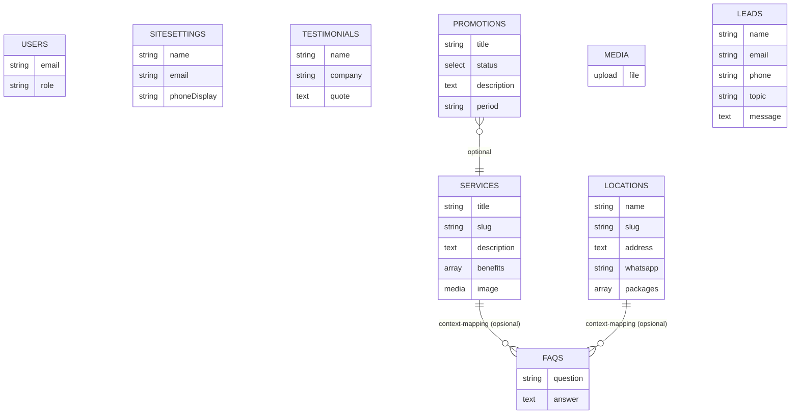

# PHASE 2A.3 — REKOMENDASI FINAL SCHEMA DATABASE EASYOFFICE

**Project:** `/Users/4ntith3sis/Documents/My project/fix build/easyoffice`  
**Referensi:** `PHASE-1-AUDIT-REPORT.md`, `PHASE-2A-SCHEMA-DRAFT.md`, `PHASE-2A.1-SCHEMA-RECONCILIATION.md`, `PHASE-2A.2-DATA-MAPPING.md`, `lib/data/mock-data.ts` (848 baris), `types/index.ts`, halaman & komponen terkait  
**Status:** Hanya analisis & dokumentasi. **Tidak ada implementasi, instalasi, migrasi, seed, perubahan source code/config/DB.**

---

## 1. Ringkasan Rekomendasi

Rekomendasi ini berfokus pada **schema paling sederhana** yang tetap kompatibel dengan frontend yang ada, dengan tetap mematuhi baseline requirement:

- **Pertahankan 8 collections + 1 global:** `Services`, `Locations`, `Testimonials`, `Promotions`, `FAQs`, `Media`, `Leads`, `Users`, `SiteSettings`
- **Packages wajib bersarang di `Locations`** (`Locations.packages[]`), bukan collection terpisah.
- **Promotions:** status `Active`/`Inactive`. Promosi `Inactive` tetap tersimpan di CMS, **tidak ditampilkan** ke pengunjung.
- **FAQs tetap collection utama**. 
- **Media lokal** dengan **URL Unsplash tetap dipertahankan** sampai strategi migrasi disetujui.
- **Tidak menambah collection/global otomatis** tanpa dasar kebutuhan dari kode/laporan.
- **Belum memutuskan menambah `ServiceLocations`** - hanya akan direkomendasikan jika terbukti mutlak diperlukan dengan persetujuan eksplisit.

---

## 2. Baseline yang Dipertahankan

| Entitas | Tipe | Status | Catatan |
|---------|------|--------|---------|
| `Services` | Collection | **Dipertahankan** | Katalog layanan umum |
| `Locations` | Collection | **Dipertahankan** | Lokasi + `packages[]` nested (wajib) |
| `Testimonials` | Collection | **Dipertahankan** | Hanya field yang dibutuhkan (name, company, quote) |
| `Promotions` | Collection | **Dipertahankan** | Status `Active`/`Inactive` |
| `FAQs` | Collection | **Dipertahankan** | Tetap collection utama |
| `Media` | Collection | **Dipertahankan** | Local upload, jaga remote Unsplash |
| `Leads` | Collection | **Dipertahankan** | Berdasarkan form kontak yang ada |
| `Users` | Collection (Auth) | **Dipertahankan** | Role `admin`/`editor` |
| `SiteSettings` | Global (Singleton) | **Dipertahankan** | Hanya info umum |

---

## 3. Temuan Utama dari Laporan Sebelumnya

- **Relasi Services–Locations saat ini** ditentukan oleh keberadaan kombinasi di `serviceLocations[]` (`lib/data/mock-data.ts:341-745`). `locationsForService(slug)` mengembalikan lokasi yang tersedia untuk layanan tertentu; `getServiceLocation(serviceSlug, locationSlug)` mengambil data agregat per kombinasi.
- **Halaman detail** (`app/layanan/[service]/[location]/page.tsx`) bergantung pada `combo` yang berisi `tagline`, `startingPrice`, `pricing[]`, `facilities[]`, `faqs[]`, `whatsapp?`, `image`, `imageAlt`, `gallery[]`.
- **Halaman landing layanan** (`app/layanan/[service]/page.tsx`) menampilkan lokasi tersedia via `ServiceLocationGrid` dan mengambil FAQ preview dari combo.
- **Pricing** saat ini berada di level `ServiceLocation` per kombinasi. Baseline mewajibkan **packages di `Locations`**.
- **Beberapa data sangat spesifik per kombinasi** (tagline, galeri unik, beberapa fasilitas/FAQ) dan belum punya tempat jelas di model minimal Services+Locations.

---

## 4. Rekomendasi Schema Setiap Collection dan Global

### 4.1 Services (Collection)
**Tujuan:** Sumber data umum layanan.

| Field | Tipe Payload (usulan) | Required | Validasi | Keterangan |
|---|---|---|---|---|
| `title` | Text | Ya | - | **Bukti:** `Service.title` (`types/index.ts:21`) |
| `slug` | Text | Ya | Unik, lowercase-hyphen | **Bukti:** Digunakan routing `generateStaticParams` |
| `shortTitle` | Text | Opsional | - | Ada di tipe, berguna UI |
| `description` | Textarea | Ya | - | **Bukti:** Digunakan di overview |
| `intro` | Textarea | Ya | - | **Bukti:** Hero halaman layanan |
| `benefits` | Array of Text | Ya | - | **Bukti:** Ditampilkan di landing layanan |
| `features` | Array of Text | Opsional | - | Ada di tipe; hanya jika dipakai |
| `icon` | Text | Opsional | - | Ada di tipe; verifikasi pemakaian |
| `image` | Upload/Media atau Text (URL) | Ya | - | **Bukti:** Unik per service |
| `imageAlt` | Text | Ya | - | Aksesibilitas |
| `href` | Text | Opsional | - | **Rekomendasi teknis:** bisa diturunkan dari slug |

**Relationship:** Belum wajib ditentukan ke Locations; ketersediaan bisa ditentukan via packages/relasi terpisah.  
**Belum diputuskan:** Bentuk relasi eksplisit Services–Locations.

### 4.2 Locations (Collection)
**Tujuan:** Sumber data umum lokasi + **packages nested** (wajib).

| Field | Tipe Payload (usulan) | Required | Validasi | Keterangan |
|---|---|---|---|---|
| `name` | Text | Ya | - | **Bukti:** `Location.name` |
| `slug` | Text | Ya | Unik | **Bukti:** Digunakan filter/routing |
| `shortDescription` | Textarea | Ya | - | **Bukti:** Digunakan UI |
| `address` | Textarea | Ya | - | **Bukti:** Ditampilkan |
| `operatingHours` | Text | Ya | - | **Bukti:** Ditampilkan |
| `email` | Email | Ya | Format email | **Bukti:** Kontak |
| `phoneDisplay` | Text | Ya | - | **Bukti:** Ditampilkan |
| `whatsapp` | Text | Ya | - | **Bukti:** Untuk WA per lokasi |
| `image` | Upload/Media atau Text (URL) | **Perlu konfirmasi** | - | Requirement menyebut "Gambar kantor" - perlu putusan wajib/opsional |
| `packages` | Array of Blocks/Objects (nested) | **Ya (wajib)** | - | **Baseline wajib.** Lihat §7 |

**Struktur `packages[]` (minimal berdasarkan `PricingPlan`):**
| Subfield | Tipe | Required | Keterangan |
|---|---|---|---|
| `name` | Text | Ya | Nama paket |
| `description` | Textarea | Opsional | Deskripsi paket (jika ada kebutuhan) |
| `price` | Text | Ya | Harga |
| `period`/`unit` | Text | Ya | Periode/unit harga |
| `features` | Array of Text | Ya | Fitur paket |
| `discountInfo` | Text | Opsional | Hanya jika terbukti dibutuhkan |
| `featured` | Checkbox | **Hanya rekomendasi teknis** | Bukan keputusan bisnis terkonfirmasi |
| `ctaLabel` | Text | **Hanya rekomendasi teknis** | Bisa diturunkan |

**Relationship:** Bisa memiliki relasi ke Services (many-to-many) atau ketersediaan ditentukan dari packages. **Belum diputuskan**.

### 4.3 Testimonials (Collection)
| Field | Tipe | Required | Keterangan |
|---|---|---|---|
| `name` | Text | Ya | **Bukti:** Digunakan di marquee |
| `company` | Text | Ya | **Bukti:** Digunakan |
| `quote` | Textarea | Ya | **Bukti:** Digunakan |

**Opsional (tidak direkomendasikan tanpa bukti):** `avatar`, `isFeatured`, `order`.

### 4.4 Promotions (Collection)
| Field | Tipe | Required | Keterangan |
|---|---|---|---|
| `badge` | Text | Ya | **Bukti:** Ditampilkan |
| `title` | Text | Ya | **Bukti:** Ditampilkan |
| `description` | Textarea | Ya | **Bukti:** Ditampilkan |
| `period` | Text | Ya | **Bukti:** Ditampilkan |
| `status` | Select (`Active`, `Inactive`) | Ya | **Baseline wajib.** `Inactive` tetap tersimpan, **tidak ditampilkan** ke pengunjung |
| `image` | Upload/URL | Opsional | Bisa disesuaikan strategi media |
| `relatedService` | Relationship -> Services | Opsional | **Hanya jika diperlukan** sesuai requirement. Saat ini ada mapping di frontend. |

### 4.5 FAQs (Collection)
| Field | Tipe | Required | Keterangan |
|---|---|---|---|
| `question` | Text | Ya | **Bukti:** Digunakan di berbagai tempat |
| `answer` | Textarea/RichText | Ya | **Bukti:** Digunakan |
| `category`/`context` | Select/Text | Opsional | **Hanya rekomendasi** untuk membedakan konteks tanpa memindahkan ke Global |

**Catatan:** Tetap sebagai **collection utama** per baseline. FAQ spesifik per kombinasi perlu strategi pemetaan (relasi/filter) tanpa membuat Global `GeneralFaqs` otomatis.

### 4.6 Media (Collection)
- **Tipe:** Upload lokal ke `public/media`
- **URL eksternal:** **Pertahankan** URL Unsplash yang sudah digunakan (`next.config.ts` sudah mengizinkan `images.unsplash.com`)
- **Status:** Jangan unduh/pindahkan aset pada fase ini

### 4.7 Leads (Collection)
| Field | Tipe (usulan) | Required | Keterangan |
|---|---|---|---|
| `name` | Text | Ya | Dari form |
| `business` | Text | Opsional | Dari form |
| `email` | Email | Ya | Dari form |
| `phone` | Text | Ya | Dari form |
| `topic` | Text/Select | Ya | Dari form (`topics` array) |
| `message` | Textarea | Ya | Dari form |
| `source` | Text | Opsional | **Rekomendasi teknis** untuk tracking |

**Catatan:** Saat ini form mengarahkan ke WhatsApp. Penyimpanan di CMS adalah baseline requirement - pola integrasi perlu diperhatikan nanti tanpa menambah mekanisme pengumpulan baru.

### 4.8 Users (Collection - Auth)
| Field | Tipe | Required | Keterangan |
|---|---|---|---|
| `email` | Email | Ya | Auth |
| `password` | Password (hashed) | Ya | Auth |
| `name` | Text | Opsional | Identifikasi |
| `role` | Select (`admin`, `editor`) | Ya (rekomendasi) | Sesuai kebutuhan yang dibahas. **Belum membuat akun/kredensial.** |

### 4.9 SiteSettings (Global - Singleton)
| Field | Tipe | Required | Keterangan |
|---|---|---|---|
| `name` | Text | Ya | **Bukti:** `site.name` |
| `tagline` | Textarea | Ya | **Bukti:** Digunakan di footer |
| `email` | Email | Ya | **Bukti:** Digunakan di footer/kontak |
| `phoneDisplay` | Text | Ya | **Bukti:** Digunakan di footer/kontak |
| `whatsappDefault` | Text | Opsional | **Rekomendasi teknis** hanya jika dibutuhkan sebagai fallback global |

**Penting:** Jangan memindahkan info spesifik lokasi (alamat/jam operasional per lokasi) ke Global.

---

## 5. Diagram Hubungan Entitas (Rekomendasi Final)

**Catatan diagram:** Diagram ini **mencerminkan rekomendasi minimal** tanpa menampilkan `ServiceLocations` sebagai keputusan final. Relasi Services–Locations **belum digambar sebagai hubungan wajib** karena bentuknya masih perlu diputuskan (lihat §6).

---

## 6. Perbandingan Model Services–Locations dengan dan tanpa `ServiceLocations`

### Alternatif A — Tanpa collection `ServiceLocations` (Rekomendasi Saat Ini)
**Pendekatan:** Gunakan `Services` dan `Locations` dengan relasi/struktur yang sesuai. `Locations.packages[]` berisi paket. Ketersediaan layanan per lokasi ditentukan via relasi atau dari data packages.

| Aspek | Penilaian | Keterangan |
|---|---|---|
| **Kesesuaian baseline** | **Baik** | Sesuai dengan "packages di Locations" dan tidak menambah collection baru |
| **Kesederhanaan CMS** | **Baik** | Lebih sedikit collection, lebih mudah dipahami |
| **Kompatibilitas frontend** | **Perlu verifikasi** | Bisa bekerja jika data bisa dinormalisasi, tapi beberapa field spesifik per kombinasi (tagline, galeri unik, facilities spesifik per combo) perlu dipetakan |
| **Duplikasi data** | **Rendah** | Menghindari duplikasi info umum |
| **Fleksibilitas harga per (service,location)** | **Perlu solusi** | Konflik dengan packages di Locations jika paket benar-benar berbeda per kombinasi (lihat §7) |
| **generateStaticParams** | **Perlu sumber lain** | Saat ini dari `serviceLocations[]`; perlu dibangun dari kombinasi valid |

### Alternatif B — Dengan collection `ServiceLocations`
**Pendekatan:** Setiap dokumen = 1 kombinasi (service, location). Referensikan `Services` dan `Locations` (jangan gandakan data umum). Simpan hanya **data khusus kombinasi**.

| Aspek | Penilaian | Keterangan |
|---|---|---|
| **Kesesuaian baseline** | **Perlu persetujuan** | **Belum disetujui**. Menambah collection di luar baseline yang disebutkan |
| **Kesederhanaan CMS** | **Lebih kompleks** | Tambah collection + relasi + perlu mencegah duplikasi (service+location) |
| **Kompatibilitas frontend** | **Sangat baik** | Paling mirip struktur mock saat ini (`getServiceLocation`, `generateStaticParams` mudah) |
| **Duplikasi data** | **Risiko** | Harus **hanya** referensikan, jangan duplikasi `Services`/`Locations` |
| **Fleksibilitas** | **Tinggi** | Cocok untuk tagline, galeri unik, facilities/faqs spesifik, override WA per kombinasi |
| **Database** | **Aman** | Tetap PostgreSQL yang sama, bukan database terpisah |

**Rekomendasi:** **Pilih Alternatif A** sebagai baseline implementasi. **Jangan adopsi Alternatif B secara otomatis.** Jika setelah mapping data terbukti ada informasi penting yang **tidak bisa** ditempatkan di A tanpa mengorbankan kebutuhan frontend, **ajukan Alternatif B dengan justifikasi bukti dan minta persetujuan eksplisit** sebelum implementasi.

---

## 7. Rekomendasi Penanganan Packages dan Pricing

### Kondisi saat ini (fakta)
- `serviceLocations[].pricing[]` berisi `PricingPlan[]` dengan `name`, `price`, `period`, `features[]`, `featured?`, `ctaLabel` (`types/index.ts:47-54`, `lib/data/mock-data.ts:341-745`)
- `PricingTable` (`components/sections/pricing-table.tsx`) menerima `plans` prop
- Di beberapa kasus, paket bisa berbeda antar lokasi dan bisa berbeda per layanan dalam konteks yang sama

### Ketentuan (tidak boleh berubah)
**Packages wajib berada di dalam `Locations`** (`Locations.packages[]`), bukan collection terpisah.

### Solusi yang diusulkan
| Pendekatan | Deskripsi | Evaluasi |
|---|---|---|
| **1. Packages di Locations (utama)** | Letakkan semua paket di `Locations.packages[]`. Pastikan struktur mencakup `name`, `price`, `period`, `features[]`. | **Sesuai baseline.** Perlu diverifikasi semua kasus di mock bisa dipetakan. |
| **2. Tentukan paket yang berlaku** | Jika satu lokasi punya paket untuk layanan berbeda, bisa ditambahkan field penanda (mis. `applicableServices[]` atau `serviceContext`) di dalam `packages[]`, atau tentukan berdasarkan konteks halaman. | **Perlu persetujuan** jika menambah field semacam ini - bukan keputusan otomatis. |
| **3. Fallback/derivasi** | `startingPrice` bisa diturunkan dari paket termurah di lokasi untuk konteks tertentu. | **Rekomendasi teknis** jika perlu. |

**Konflik penting:** Jika harga paket **benar-benar berbeda per layanan di lokasi yang sama** dan tidak bisa direpresentasikan oleh struktur di Locations, **tidak boleh** memindahkan Packages ke collection baru secara diam-diam. Harus dilaporkan sebagai konflik dengan solusi alternatif dan **diminta persetujuannya** sebelum mengubah baseline.

**Rekomendasi:** Terapkan packages di `Locations` terlebih dahulu. Lakukan mapping lengkap dari `serviceLocations[].pricing[]` ke `Locations.packages[]` saat desain data access layer; jika ada informasi yang hilang atau tidak bisa dipetakan, **hentikan dan minta keputusan**.

---

## 8. Strategi Data Umum Versus Data Khusus Kombinasi

| Data | Kategori | Rekomendasi Penempatan | Catatan |
|---|---|---|---|
| `Services.*` (umum) | Umum | **Services** | title, description, intro, benefits, image layanan |
| `Locations.*` (umum) | Umum | **Locations** | alamat, kontak, whatsapp lokasi, operatingHours + **packages[]** |
| `tagline` | **Spesifik kombinasi** | **Belum pasti** - bisa di konteks kombinasi atau perlu tempat lain | Digunakan di hero/metadata halaman detail. Perlu keputusan. |
| `startingPrice` | **Bisa diturunkan** | Bisa dari `packages` terendah atau spesifik per kombinasi | Perlu verifikasi. |
| `pricing[]`/packages | **Perlu klarifikasi** | **Wajib di Locations** per baseline; namun bisa berbeda per layanan | Konflik - lihat §7 |
| `facilities[]` | **Bisa spesifik** | Jika umum bisa dipetakan, jika spesifik per combo **perlu tempat** | Homepage pakai `allFacilities`, detail pakai `combo.facilities` |
| `faqs[]` | **Bisa campuran** | FAQs collection dengan pemetaan; FAQ spesifik perlu strategi | Jangan jadi Global otomatis |
| `whatsapp` override | **Spesifik** | Bisa di konteks kombinasi atau di Locations | Ada di mock sebagai optional override |
| `image`, `imageAlt`, `gallery[]` | **Spesifik kombinasi** | Perlu tempat jika berbeda signifikan per combo | Unik per kombinasi di mock |
| `Testimonials` | Umum | **Testimonials** collection | Dipakai di berbagai halaman |
| `Promotions` | Umum/dengan konteks | **Promotions** dengan `status` + `relatedService` opsional | Mapping saat ini hardcoded ke service tertentu |
| `SiteSettings` | Umum | **SiteSettings Global** | Hanya info global |
| `Leads` | Umum | **Leads** collection | Dari form kontak |

---

## 9. Dampak Terhadap Route dan Frontend yang Ada

| Aspek | Dampak | Rekomendasi |
|---|---|---|
| **Route** | **Minimal** - tidak perlu diubah | Tetap pakai pola `/layanan/[service]` dan `/layanan/[service]/[location]` |
| **`app/layanan/[service]/page.tsx`** | Perlu adaptasi sumber data | `getService`, `locationsForService` harus bisa direkonstruksi. `generateStaticParams` dari `services` bisa tetap |
| **`app/layanan/[service]/[location]/page.tsx`** | Perlu adaptasi sumber data | Butuh kombinasi valid untuk `generateStaticParams`. Jika tanpa `ServiceLocations`, perlu sumber alternatif. `getServiceLocation` perlu dinormalisasi. |
| **Komponen sections** | **Minimal jika dinormalisasi** | `PricingTable`, `FacilitiesGrid`, `FaqSection`, `Gallery`, `LocationCard`, `Hero` - prop interface bisa dipertahankan, hanya sumber data berubah |
| **Helper functions** | **Perlu adaptasi** | Nama fungsi tidak wajib sama persis. Yang penting **bentuk data kompatibel** dengan tipe di `types/index.ts` |
| **Images/Next/Image** | **Aman** | `remotePatterns` untuk Unsplash sudah ada; local media bisa ditambahkan nanti |
| **WhatsApp/CTA** | **Aman** | Logika WA tetap bisa dipertahankan |

**Prinsip:** **Jangan ubah route, komponen, atau UI.** Ganti sumber data lewat data access layer (Payload Local API) dengan normalisasi.

---

## 10. Daftar Keputusan yang Sudah Dapat Ditetapkan Secara Teknis

| Keputusan | Alasan (berdasarkan fakta) |
|---|---|
| **8 collections + 1 global** sesuai baseline | Sudah disebutkan di requirement dan laporan |
| **Packages di `Locations.packages[]`** (wajib, bukan collection) | Baseline requirement tegas |
| **Promotions `Active`/`Inactive`** | Baseline requirement tegas; inactive tetap tersimpan, tidak ditampilkan |
| **FAQs tetap collection** | Baseline requirement tegas |
| **Media lokal + pertahankan URL Unsplash** | Baseline requirement |
| **Users dengan role admin/editor** | Baseline requirement |
| **SiteSettings hanya info umum** | Baseline requirement |
| **Leads dari form kontak yang ada** | Baseline requirement, hanya field form yang ada |
| **Tidak menambah collection/global otomatis** | Sesuai batasan Phase 2A.3 |
| **Puck ditunda, tidak ada Docker** | Sesuai arsitektur yang disepakati |
| **Frontend/route dipertahankan** | Sesuai batasan |

---

## 11. Daftar Keputusan yang Masih Memerlukan Persetujuan

| Keputusan | Pertanyaan untuk Persetujuan | Dampak |
|---|---|---|
| **A. Perlu menambah collection `ServiceLocations`?** | Apakah ada data spesifik per (service,location) yang **mutlak tidak bisa** ditempatkan di Services/Locations/packages setelah mapping lengkap? Jika ya, bisakah disebutkan elemen mana saja? | Menambah collection vs kompleksitas model. Alternatif B vs A. |
| **B. Bentuk relasi Services–Locations** | Bagaimana "layanan tersedia di lokasi" didefinisikan? Apakah via relasi many-to-many, via packages di Locations, atau cara lain? | Menentukan cara membangun `locationsForService` dan `generateStaticParams`. |
| **C. Penanganan harga beda per (service,location)** | Jika satu lokasi punya paket berbeda untuk layanan berbeda, bagaimana merepresentasikannya di `Locations.packages[]` tanpa membuat collection Packages terpisah? Perlu konfirmasi skenario bisnis. | Menyelesaikan konflik packages vs pricing per kombinasi. |
| **D. Penempatan tagline/startingPrice/gallery/facilities spesifik** | Elemen mana yang wajib dikelola terpisah untuk halaman `/layanan/[service]/[location]`? | Bisa menentukan perlu/tidaknya entitas perantara. |
| **E. FAQ spesifik per konteks** | Bagaimana memetakan FAQ per layanan/lokasi ke FAQs collection tanpa Global baru? Perlu strategi yang disetujui. | Struktur FAQs dan query. |
| **F. Comparison table** | Perlu dikelola di CMS (collection/global) atau tetap statis? | Menambah entitas atau tidak. |
| **G. Facilities** | Perlu dikelola terpusat (collection) atau cukup nested/sumber saat ini? | Menambah entitas atau tidak. |
| **H. Gambar kantor di Locations** | Apakah `Locations.image` wajib atau opsional? | Field wajib/opsional. |

---

## 12. Risiko, Trade-off, dan Langkah Selanjutnya

### Risiko
| Risiko | Tingkat | Mitigasi |
|---|---|---|
| **Konflik packages vs harga per kombinasi** | **Tinggi** | Ikuti baseline (packages di Locations), mapping lengkap dulu, minta persetujuan jika tidak bisa dipetakan |
| **Data spesifik kombinasi hilang** | **Tinggi** | Audit elemen per elemen, hanya tambah collection dengan persetujuan eksplisit |
| **generateStaticParams rusak** | **Sedang-Tinggi** | Pastikan ada sumber daftar kombinasi valid sebelum menghapus ketergantungan pada `serviceLocations[]` |
| **Normalisasi data kompleks** | **Sedang** | Buat data access layer yang hati-hati untuk menjaga kompatibilitas frontend |
| **Media eksternal** | **Rendah** | Pertahankan remotePatterns Unsplash |

### Trade-off
- **Sederhana vs Fleksibel:** Model minimal (tanpa `ServiceLocations`) lebih sederhana tapi mungkin kurang fleksibel untuk kasus spesifik per kombinasi.
- **Patuh baseline vs Kompatibel frontend:** Harus menjaga keduanya; jika bertentangan, **laporkan dan minta persetujuan**, jangan memutuskan sendiri.
- **Collections minimal vs kebutuhan pengelolaan:** Hanya tambah jika ada kebutuhan yang terbukti.

### Langkah Selanjutnya (HANYA SETELAH PERSETUJUAN)
1. **Dapatkan persetujuan** atas keputusan di §11
2. **Finalisasi schema** berdasarkan persetujuan
3. **Install Payload** dan setup konfigurasi (hanya jika disetujui)
4. **Buat collections/globals** sesuai schema final
5. **Setup koneksi DB** ke `easyoffice_cms` (setelah verifikasi aman)
6. **Migration + seed bertahap** dengan strategi idempotent
7. **Integrasi frontend** via Payload Local API dengan normalisasi

**Saat ini:** Hanya analisis & rekomendasi. **Tidak ada langkah 1-7 yang dilakukan.**

---

## RINGKASAN AKHIR PHASE 2A.3

- **File dibuat:** `PHASE-2A.3-SCHEMA-RECOMMENDATION.md`
- **Perubahan:** **Tidak ada** - tidak ada source code, config, dependency, database, atau dokumen lain yang diubah/ditimpa.
- **Baseline dipertahankan:** 8 collections + 1 global sesuai requirement. **Packages wajib di `Locations.packages[]`**.
- **Rekomendasi:** Mulai dari model minimal **tanpa `ServiceLocations`** (Alternatif A). Tambah collection perantara **hanya jika terbukti mutlak perlu dan disetujui eksplisit**.
- **Konflik teridentifikasi:** Packages di Locations vs pricing spesifik per (service,location) di mock; data spesifik kombinasi perlu dipetakan dengan hati-hati.
- **Menunggu persetujuan:** 8 poin keputusan di §11 perlu persetujuan sebelum implementasi.
- **Status:** Phase 2A.3 selesai. **Berhenti. Tidak melanjutkan ke implementasi/migrasi/seed tanpa instruksi eksplisit.**
