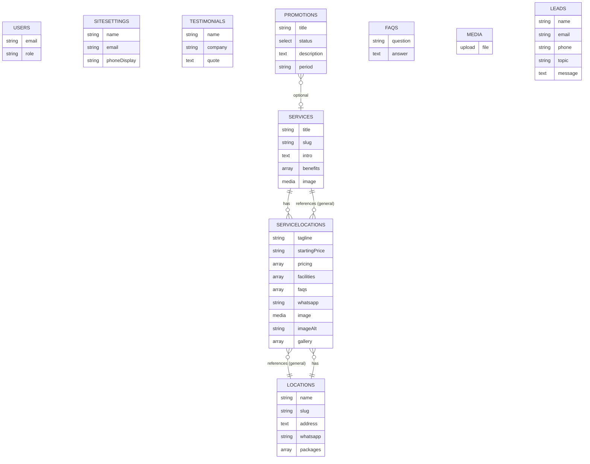

# PHASE 2A.4 — ANALISIS MODEL KONTEN INDEPENDEN PER LAYANAN-LOKASI

**Project:** `/Users/4ntith3sis/Documents/My project/fix build/easyoffice`  
**Referensi:** `PHASE-1-AUDIT-REPORT.md`, `PHASE-2A-SCHEMA-DRAFT.md`, `PHASE-2A.1-SCHEMA-RECONCILIATION.md`, `PHASE-2A.2-DATA-MAPPING.md`, `PHASE-2A.3-SCHEMA-RECOMMENDATION.md`, `lib/data/mock-data.ts` (848 baris), `types/index.ts`, route/helper/komponen terkait  
**Keputusan terbaru:** **Pilihan C** — Setiap halaman layanan-lokasi dapat dikelola hampir sepenuhnya secara terpisah oleh admin (Virtual Office Bandung berbeda dari Virtual Office Jakarta, Coworking Space Bandung berbeda dari Virtual Office Bandung). Perubahan satu kombinasi tidak boleh memengaruhi kombinasi lain.  
**Status:** Hanya analisis & dokumentasi. **Tidak ada implementasi, instalasi, migrasi, seed, perubahan source/config/DB/laporan sebelumnya.**

---

## 1. Ringkasan Keputusan Pilihan C

Pilihan C menegaskan **kebutuhan pengelolaan konten independen** per kombinasi (service, location). Namun, ini **bukan persetujuan otomatis** untuk menambah collection `ServiceLocations`. Analisis ini membuktikan model mana yang paling sesuai berdasarkan kode aktual dan menjelaskan konsekuensinya.

---

## 2. Fakta Hasil Audit yang Mendukung Rekomendasi

Dari pemeriksaan kode aktual:

- **Tipe gabungan:** `ServiceLocation` di `types/index.ts:99-119` merepresentasikan kombinasi unik `serviceSlug` + `locationSlug`. Komentar menyatakan: *"A unique service offering: Service + Location. Pricing, facilities, FAQs, and contact belong to this combination, so the same package name may carry different prices per location."*
- **Data agregat per kombinasi:** `serviceLocations[]` di `lib/data/mock-data.ts:341-745` menyimpan `tagline`, `startingPrice`, `pricing[]`, `facilities[]`, `faqs[]`, `whatsapp?`, `image`, `imageAlt`, `gallery[]` (3 foto unik per kombinasi).
- **Routing dinamis:** `app/layanan/[service]/[location]/page.tsx:23-28` membangun `generateStaticParams` dari **seluruh** `serviceLocations`. Halaman mengambil data via `getServiceLocation(serviceSlug, locationSlug)`.
- **Landing layanan:** `app/layanan/[service]/page.tsx:53-137` menggunakan `locationsForService(service.slug)` untuk menampilkan lokasi tersedia dan mengambil `preview = getServiceLocation(...)` untuk FAQ preview.
- **Komponen:** `LocationCard` menampilkan `combo.tagline` dan `combo.startingPrice` (`components/sections/location-card.tsx:35,43`). `PricingTable` menerima `plans={combo.pricing}`. `Gallery` menerima `images={combo.gallery}`. `FaqSection` menerima `faqs={combo.faqs}` atau `preview.faqs`.
- **Helper:** `getServiceLocation`, `locationsForService` ada di `lib/data/mock-data.ts:746-765`. Tidak ditemukan `getServiceLocationsForLocation` sebagai fungsi terpisah di mock saat ini (disebut di laporan sebelumnya sebagai referensi, namun **tidak ada di kode aktual**).

**Fakta kunci:** Di implementasi saat ini, **hampir seluruh konten halaman detail** bersumber dari entitas gabungan per kombinasi. Ini selaras dengan kebutuhan "dikelola hampir sepenuhnya secara terpisah" pada Pilihan C.

---

## 3. Perbandingan Model A, B, C

### Model A — Tanpa collection `ServiceLocations`
**Asumsi:** Hanya `Services` dan `Locations` + relasi many-to-many.

| Aspek | Penilaian | Penjelasan |
|---|---|---|
| **Pengelolaan independen per kombinasi** | **Sulit** | Jika data seperti `tagline`, galeri unik, fasilitas spesifik per kombinasi disimpan hanya di `Services` atau `Locations`, perubahan di satu kombinasi bisa berdampak atau sulit diisolasi. Admin tidak akan bisa mengedit "Virtual Office Bandung" terpisah dari "Virtual Office Jakarta" dengan mudah. |
| **Penempatan data khusus** | **Tidak jelas** | Tidak ada tempat alami untuk `gallery[]` unik per kombinasi, `tagline` spesifik, atau `faqs[]` spesifik tanpa menciptakan struktur yang membingungkan. |
| **Ketersediaan layanan per lokasi** | **Bisa** | Bisa ditentukan via relasi atau packages, namun perlu definisi eksplisit. |
| **generateStaticParams** | **Perlu sumber lain** | Saat ini dibangun dari `serviceLocations[]`. Jika tidak ada, perlu membangun dari kombinasi valid (Services × Locations) berdasarkan aturan tertentu. |
| **Risiko duplikasi** | **Rendah untuk data umum** | Baik untuk info umum, tapi **buruk** untuk isolasi konten per kombinasi. |
| **Kesederhanaan** | **Baik** | Lebih sedikit collection. |

**Kesimpulan A:** **Tidak cukup** untuk memenuhi kebutuhan "dikelola hampir sepenuhnya secara terpisah" tanpa solusi tambahan yang rumit.

### Model B — Data kombinasi nested dalam Services atau Locations
**Asumsi:** Simpan array data per kombinasi di dalam `Services` (mis. `locations[]` berisi data spesifik) atau di dalam `Locations` (mis. `services[]` berisi data spesifik).

| Aspek | Penilaian | Penjelasan |
|---|---|---|
| **Pengelolaan independen** | **Sedang-Buruk** | Admin harus masuk ke `Services` dan mengedit nested array yang sangat panjang, atau ke `Locations`. Risiko salah mengedit entry kombinasi lain tinggi. UI admin menjadi tidak intuitif. |
| **Kepemilikan data** | **Bingung** | Apakah data milik Service atau Location? Seperti `tagline`, galeri, FAQ spesifik - sulit menentukan pemilik. |
| **Risiko duplikasi** | **Tinggi** | Data umum bisa terduplikasi tanpa disadari. |
| **Query/normalisasi** | **Kompleks** | Untuk mendapatkan data halaman `/layanan/[service]/[location]`, perlu mencari nested entry yang cocok - query bisa lebih rumit dan rawan error. |
| **generateStaticParams** | **Mungkin bisa** | Bisa dibangun dari nested arrays, tapi perlu validasi. |
| **Skalabilitas** | **Buruk** | Semakin banyak kombinasi, nested array jadi besar dan sulit dikelola. |
| **Dampak frontend** | **Bisa kompatibel** | Data access layer bisa menormalisasi, tapi UX admin buruk. |

**Kesimpulan B:** **Tidak direkomendasikan**. Kontra terhadap kemudahan pengelolaan, kepemilikan data, dan risiko isolasi konten terlalu besar.

### Model C — Collection `ServiceLocations`
**Asumsi:** Satu dokumen per kombinasi `(service, location)`. Referensikan `Services` dan `Locations` untuk data umum, simpan **hanya data khusus kombinasi**.

| Aspek | Penilaian | Penjelasan |
|---|---|---|
| **Pengelolaan independen** | **Sangat baik** | Admin bisa masuk ke collection `ServiceLocations`, pilih kombinasi spesifik (mis. "Virtual Office - Bandung"), dan mengedit semua konten halamannya secara terpisah. Perubahan tidak memengaruhi kombinasi lain. |
| **Isolasi konten** | **Sangat baik** | Sesuai persis dengan Pilihan C. |
| **Referensi data umum** | **Baik** | Ambil `service.title/intro/benefits/image` dari relasi `service`, ambil info lokasi dari relasi `location`. **Jangan gandakan** data umum. |
| **generateStaticParams** | **Sangat cocok** | Bisa langsung dari `serviceLocations` (seperti implementasi saat ini). |
| **getServiceLocation** | **Sangat cocok** | Bisa populate relasi dan menggabungkan dengan data umum. |
| **Pencegahan duplikasi kombinasi** | **Dapat dilakukan** | Perlu unique constraint pada `(service, location)` - bisa via validasi Payload + constraint DB saat implementasi. |
| **Kompatibilitas frontend** | **Sangat baik** | Bentuk data bisa dinormalisasi agar mirip dengan `ServiceLocation` saat ini. |
| **Kompleksitas** | **Sedang** | Perlu collection tambahan, relasi, validasi uniqueness. |
| **Database** | **Aman** | **Tetap di PostgreSQL yang sama**, bukan database terpisah. |

**Kesimpulan C:** **Paling sesuai** untuk memenuhi kebutuhan "dikelola hampir sepenuhnya secara terpisah" per kombinasi.

---

## 4. Rekomendasi Model Akhir

**Rekomendasi: Model C — Collection `ServiceLocations`**

Alasan berdasarkan bukti:
1. **Kebutuhan pengelolaan independen** (Pilihan C) hanya bisa dipenuhi dengan baik oleh entitas terpisah per kombinasi.
2. **Fakta kode** menunjukkan semua konten halaman detail saat ini bersumber dari entitas gabungan per kombinasi.
3. **Model A dan B** gagal memberikan isolasi konten yang jelas dan UX admin yang baik untuk kebutuhan ini.
4. **Collection tetap di PostgreSQL yang sama** - tidak ada database terpisah.
5. **Data umum tetap direferensikan**, bukan diduplikasi - `Services` dan `Locations` tetap menjadi sumber data umum.

**PENTING:** Meskipun direkomendasikan, **collection `ServiceLocations` belum disetujui**. Ini adalah **rekomendasi berdasarkan analisis kebutuhan pengelolaan yang telah disepakati**, namun perlu **persetujuan eksplisit** sebelum ditambahkan ke schema.

---

## 5. Tabel Pemetaan Field Umum vs Khusus Kombinasi

| Field | Kategori | Lokasi Rekomendasi | Wajib/Opsional | Digunakan Oleh | Catatan |
|---|---|---|---|---|---|
| **Service.title/description/intro/benefits/image** | **Umum** | `Services` (referensi) | Sesuai schema Services | Hero landing/detail, overview | **Jangan diduplikasi** ke ServiceLocations |
| **Location.name/address/whatsapp/operatingHours/etc** | **Umum** | `Locations` (referensi) | Sesuai schema Locations | LocationDetailCard, WA, footer context | **Jangan diduplikasi** ke ServiceLocations |
| **Location.packages[]** | **Umum (lokasi)** | `Locations.packages[]` (**wajib nested**) | Ya | `PricingTable` (setelah pemetaan) | Lihat §6 - tetap di Locations |
| **tagline** | **Khusus kombinasi** | **ServiceLocations.tagline** | Ya | `app/layanan/[service]/[location]/page.tsx:41,71`, `LocationCard:35` | Sangat spesifik per kombinasi di mock |
| **startingPrice** | **Khusus kombinasi / bisa diturunkan** | **Perlu putusan** - bisa di ServiceLocations atau diturunkan dari packages | Perlu konfirmasi | `LocationCard:43` | Bisa diturunkan dari `packages` terendah, tapi di mock spesifik per combo |
| **pricing[]** | **Khusus kombinasi (saat ini)** | **Konflik** - baseline ingin packages di Locations, tapi mock punya di combo | **Perlu putusan** | `PricingTable` | Lihat §6 |
| **facilities[]** | **Bisa spesifik** | Jika spesifik per combo → **ServiceLocations.facilities[]**. Jika umum bisa dari sumber lain | Perlu konfirmasi | `app/layanan/[service]/[location]/page.tsx:132`, `FacilitiesGrid` | Homepage pakai `allFacilities` (umum), detail pakai `combo.facilities` (bisa beda) |
| **faqs[]** | **Bisa spesifik** | **ServiceLocations.faqs[]** atau relasi ke `FAQs` collection dengan konteks | Perlu konfirmasi | `app/layanan/[service]/page.tsx:157` (preview), `app/layanan/[service]/[location]/page.tsx:137` | Tetap bisa pakai collection `FAQs` dengan mapping, atau nested |
| **whatsapp** (override) | **Khusus kombinasi** | **ServiceLocations.whatsapp** (opsional) | Opsional | `app/layanan/[service]/[location]/page.tsx:59-66` - fallback ke location | Ada di mock sebagai override |
| **image** | **Khusus kombinasi** | **ServiceLocations.image** | Ya (berdasarkan mock) | Hero halaman detail | Unik per kombinasi |
| **imageAlt** | **Khusus kombinasi** | **ServiceLocations.imageAlt** | Ya | Hero | Aksesibilitas |
| **gallery[]** | **Khusus kombinasi** | **ServiceLocations.gallery[]** | Ya (3 items di mock) | `Gallery` component | Unik per kombinasi |

---

## 6. Analisis Packages dan Variasi Harga

### Kondisi wajib (tidak boleh diubah)
**Packages wajib tetap nested di `Locations.packages[]`**, bukan collection terpisah.

### Temuan dari mock
- `pricing[]` saat ini ada di setiap `ServiceLocation` (`lib/data/mock-data.ts:341-745`)
- Komentar di `types/index.ts:99-101`: *"Pricing, facilities, FAQs, and contact belong to this combination, so the same package name may carry different prices per location."*
- `PricingTable` menerima `plans={combo.pricing}`

### Skenario yang perlu diakomodasi
1. **Satu lokasi, beberapa layanan** - paket bisa berbeda per layanan
2. **Paket berbeda harga untuk layanan berbeda di lokasi sama** - seperti yang disebutkan di tipe
3. **Paket/fitur hanya berlaku untuk layanan tertentu**
4. **Setiap halaman layanan-lokasi punya daftar harga tersendiri**

### Solusi (tanpa mengubah baseline)
**Opsi yang tetap menghormati "packages di Locations":**
- Tambahkan field di `packages[]` nested: `applicableServices[]` (array of slugs/relasi ke Services) atau `appliesToServices`. 
- Saat menampilkan harga untuk halaman `/layanan/[service]/[location]`, filter `locations.packages` berdasarkan layanan yang berlaku.
- `startingPrice` bisa dihitung dari paket terendah yang berlaku untuk layanan tersebut, atau disimpan di `ServiceLocations` jika tidak bisa diturunkan.

**Catatan:** Menambahkan `applicableServices` ke nested packages adalah **kandidat teknis**, bukan keputusan otomatis. Perlu **persetujuan** jika diperlukan.

**Konflik yang perlu dilaporkan:** Jika ada kasus dimana tidak mungkin merepresentasikan variasi harga hanya dengan packages di Locations (terlepas dari penanda layanan), maka model minimal tanpa entitas perantara **tidak cukup**. Dalam kasus seperti itu, **hanya dengan persetujuan eksplisit** bisa dipertimbangkan solusi lain, tanpa menghapus ketentuan packages di Locations.

---

## 7. Strategi FAQ dan Fasilitas

### FAQs
- **Tetap collection `FAQs`** per baseline
- **FAQ umum** - bisa disimpan di collection dengan kategori `general` atau diakses terpisah
- **FAQ khusus layanan-lokasi** - jika menggunakan Model C, bisa disimpan nested di `ServiceLocations.faqs[]` ATAU direlasikan ke collection `FAQs` dengan konteks. **Nested di ServiceLocations lebih mudah untuk isolasi konten per kombinasi** sesuai Pilihan C.
- **Jangan buat Global `GeneralFaqs`** secara otomatis
- **Hindari duplikasi** pertanyaan/jawaban tanpa alasan

### Fasilitas
- **`allFacilities` / `facilityPool`** untuk homepage - bisa tetap sebagai sumber terpusat atau dipetakan. **Jangan buat collection `Facilities`** tanpa bukti kebutuhan dan justifikasi.
- **Fasilitas per kombinasi** - di mock berbeda per combo (`combo.facilities[]`), digunakan di halaman detail. Jika menggunakan Model C, bisa nested di `ServiceLocations.facilities[]`. Jika tetap menggunakan Model A, sulit untuk isolasi.
- **Bedakan umum vs spesifik** - fasilitas umum bisa dibagi, fasilitas spesifik per kombinasi perlu dikelola terpisah sesuai kebutuhan pengelolaan.

---

## 8. Diagram Mermaid - Model Rekomendasi (Model C)

**Catatan:** 
- `SERVICELOCATIONS` mereferensikan `SERVICES` dan `LOCATIONS` untuk data umum, **tidak menduplikasi** seluruh data mereka.
- `packages` tetap di `LOCATIONS` per baseline requirement.
- Relasi `(service, location)` harus **unik** (dicegah duplikasi).
- Diagram ini menunjukkan **model rekomendasi (C)**, bukan sebagai keputusan final.

---

## 9. Dampak Terhadap Route, Helper, dan Komponen Frontend

| Aspek | Dampak | Penjelasan |
|---|---|---|
| **Routes** | **Tidak berubah** | Tetap `/layanan/[service]`, `/layanan/[service]/[location]` |
| **`app/layanan/[service]/[location]/page.tsx`** | **Adaptasi sumber data** | Bisa tetap menggunakan `getServiceLocation` yang akan di-populate dari collection `ServiceLocations` dengan relasi ke Services/Locations |
| **`app/layanan/[service]/page.tsx`** | **Adaptasi sumber data** | `locationsForService` bisa dibangun dari `ServiceLocations` yang terkait dengan service tertentu |
| **`generateStaticParams`** | **Kompatibel** | Sangat cocok dibangun dari semua dokumen `ServiceLocations` (mirip struktur saat ini) |
| **`getService`, `getLocation`** | **Tetap dipakai** | Untuk data umum dari Services/Locations |
| **`getServiceLocation`** | **Tetap dipakai** | Perlu adaptasi untuk menggabungkan data dari `ServiceLocations` + relasi Services/Locations + packages dari Locations |
| **Komponen** | **Tidak diubah** | `PricingTable`, `FacilitiesGrid`, `FaqSection`, `Gallery`, `LocationCard`, `Hero`, `WhatsappCta`, `ServiceLocationGrid` - hanya sumber data yang berubah via normalisasi |
| **UI/Behavior** | **Tidak berubah** | Tampilan dan perilaku tetap sama |

---

## 10. Daftar Keputusan yang Sudah Ditetapkan

| Keputusan | Status |
|---|---|
| Baseline 8 collections + 1 global dipertahankan | **Ditentukan** |
| Packages wajib di `Locations.packages[]`, bukan collection terpisah | **Ditentukan** |
| Promotions `Active`/`Inactive` (inactive tetap tersimpan, tidak ditampilkan) | **Ditentukan** |
| FAQs tetap collection utama | **Ditentukan** |
| Media lokal, URL Unsplash dipertahankan | **Ditentukan** |
| Users role admin/editor | **Ditentukan** |
| SiteSettings hanya info umum | **Ditentukan** |
| Leads dari form kontak yang ada | **Ditentukan** |
| Puck ditunda, tidak ada Docker | **Ditentukan** |
| Route/UI/frontend dipertahankan | **Ditentukan** |

---

## 11. Daftar Keputusan yang Masih Memerlukan Persetujuan

| Keputusan | Penjelasan | Urgensi |
|---|---|---|
| **1. Menambah collection `ServiceLocations`** | Model C paling sesuai untuk kebutuhan "dikelola hampir sepenuhnya secara terpisah". Namun **belum disetujui**. Perlu persetujuan eksplisit. | **Tinggi** |
| **2. Struktur unik (service, location)** | Jika menambah `ServiceLocations`, perlu mencegah duplikasi kombinasi (validasi Payload + constraint DB). Perlu persetujuan cara enforce. | **Tinggi** |
| **3. Penempatan `pricing[]` vs `packages` di Locations** | Tetap di Locations per baseline, tapi perlu cara mengakomodasi harga beda per layanan di lokasi yang sama (bisa pakai `applicableServices` di packages). Perlu persetujuan. | **Tinggi** |
| **4. Field wajib di `ServiceLocations`** | Tentukan mana yang wajib vs opsional (`tagline`, `image`, `gallery`, `facilities`, `faqs`, dll). | **Sedang** |
| **5. FAQ spesifik - nested vs relasi** | Apakah `faqs[]` nested di `ServiceLocations` atau relasi ke collection `FAQs`? | **Sedang** |
| **6. Facilities spesifik - nested vs collection** | Sama seperti FAQ, perlu strategi untuk fasilitas per kombinasi. | **Sedang** |
| **7. `startingPrice` sumber** | Diturunkan dari packages atau disimpan terpisah di `ServiceLocations`? | **Sedang** |

---

## 12. Langkah Berikutnya Setelah Persetujuan

**HANYA setelah persetujuan eksplisit:**
1. Putuskan Model C (atau alternatif lain) berdasarkan persetujuan
2. Finalisasi field `ServiceLocations` jika disetujui
3. Rancang validasi uniqueness (service + location)
4. Tentukan strategi packages + applicableServices jika diperlukan
5. Lanjut ke Phase 2B (konfigurasi Payload) - **bukan otomatis**

**Saat ini:** Hanya analisis. Tidak ada langkah di atas yang dilakukan.

---

## KESIMPULAN

- **Fakta:** Implementasi saat ini sepenuhnya bergantung pada entitas gabungan per kombinasi (`serviceLocations[]`). Hal ini selaras dengan kebutuhan Pilihan C untuk pengelolaan terpisah.
- **Perbandingan:** Model A dan B **tidak memadai** untuk isolasi konten per kombinasi. **Model C (`ServiceLocations`) paling sesuai** untuk memenuhi kebutuhan pengelolaan independen.
- **Baseline:** 8 collections + 1 global tetap dipertahankan. **Packages wajib di `Locations.packages[]`**.
- **Rekomendasi:** Tambahkan collection `ServiceLocations` yang mereferensikan `Services` dan `Locations`, simpan hanya data khusus kombinasi, cegah duplikasi (service+location), dan tetap di **PostgreSQL yang sama**. 
- **Status:** **Direkomendasikan, tetapi BELUM disetujui.** Membutuhkan persetujuan eksplisit sebelum ditambahkan ke schema.
- **Perubahan:** Hanya file baru `PHASE-2A.4-CONTENT-MODEL-ANALYSIS.md` dibuat. Tidak ada perubahan lain.

**BERHENTI - Menunggu persetujuan eksplisit untuk menambah collection `ServiceLocations` atau model alternatif.**
