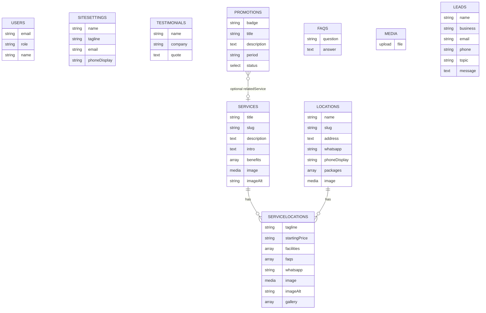

# PHASE 2A.5 — FINALISASI SCHEMA DATABASE EASYOFFICE

**Project:** `/Users/4ntith3sis/Documents/My project/fix build/easyoffice`  
**Referensi:** `PHASE-1-AUDIT-REPORT.md`, `PHASE-2A-SCHEMA-DRAFT.md`, `PHASE-2A.1-SCHEMA-RECONCILIATION.md`, `PHASE-2A.2-DATA-MAPPING.md`, `PHASE-2A.3-SCHEMA-RECOMMENDATION.md`, `PHASE-2A.4-CONTENT-MODEL-ANALYSIS.md`, `lib/data/mock-data.ts`, `types/index.ts`, route/helper/komponen terkait  
**Keputusan terbaru:** **Pilihan C** — Setiap halaman layanan-lokasi harus dapat dikelola hampir sepenuhnya secara independen.  
**Status:** Hanya analisis & dokumentasi. **Tidak ada implementasi, instalasi, migrasi, seed, perubahan source/config/DB/laporan sebelumnya.**

---

## 1. Ringkasan Keputusan

- **Baseline tetap:** 8 collections (`Services`, `Locations`, `Testimonials`, `Promotions`, `FAQs`, `Media`, `Leads`, `Users`) + 1 global (`SiteSettings`).
- **Packages wajib di Locations:** `Locations.packages[]` nested, **bukan collection terpisah**.
- **ServiceLocations direkomendasikan:** Sebagai collection tambahan untuk memenuhi kebutuhan pengelolaan independen per kombinasi (Pilihan C). **Belum disetujui** — menunggu persetujuan eksplisit.
- **Promotions:** status `Active`/`Inactive`. `Inactive` tetap tersimpan, tidak ditampilkan.
- **FAQs tetap collection.** Media lokal + URL Unsplash dipertahankan. Users role `admin`/`editor`.
- **Route/UI/frontend dipertahankan.** Puck ditunda, tidak ada Docker.

---

## 2. Baseline yang Dipertahankan

| Entitas | Tipe | Status | Keterangan |
|---------|------|--------|---------|
| `Services` | Collection | **Dipertahankan** | Data umum layanan |
| `Locations` | Collection | **Dipertahankan** | Data umum lokasi + `packages[]` nested |
| `Testimonials` | Collection | **Dipertahankan** | name, company, quote |
| `Promotions` | Collection | **Dipertahankan** | status `Active`/`Inactive` |
| `FAQs` | Collection | **Dipertahankan** | Tetap collection utama |
| `Media` | Collection | **Dipertahankan** | Local upload, jaga Unsplash remote |
| `Leads` | Collection | **Dipertahankan** | Berdasarkan form kontak yang ada |
| `Users` | Collection (Auth) | **Dipertahankan** | role `admin`/`editor` |
| `SiteSettings` | Global (Singleton) | **Dipertahankan** | Hanya info umum |

---

## 3. Rancangan Final Services, Locations, dan ServiceLocations

### 3.1 Services
**Tujuan:** Sumber data umum layanan.

| Field | Tipe (usulan) | Required | Keterangan (berdasarkan kode) |
|---|---|---|---|
| `title` | Text | Ya | `Service.title` |
| `slug` | Text | Ya | Unik, untuk routing |
| `shortTitle` | Text | Opsional | Ada di tipe |
| `description` | Textarea | Ya | `Service.description` |
| `intro` | Textarea | Ya | `Service.intro` |
| `benefits` | Array of Text | Ya | `Service.benefits[]` |
| `features` | Array of Text | Opsional | Ada di tipe |
| `icon` | Text | Opsional | Ada di tipe |
| `image` | Upload/Media atau URL | Ya | `Service.image` (unik per service) |
| `imageAlt` | Text | Ya | `Service.imageAlt` |

### 3.2 Locations
**Tujuan:** Sumber data umum lokasi + packages nested.

| Field | Tipe (usulan) | Required | Keterangan (berdasarkan kode) |
|---|---|---|---|
| `name` | Text | Ya | `Location.name` |
| `slug` | Text | Ya | Unik |
| `shortDescription` | Textarea | Ya | `Location.shortDescription` |
| `address` | Textarea | Ya | `Location.address` |
| `operatingHours` | Text | Ya | `Location.operatingHours` |
| `email` | Email | Ya | `Location.email` |
| `phoneDisplay` | Text | Ya | `Location.phoneDisplay` |
| `whatsapp` | Text | Ya | `Location.whatsapp` |
| `image` | Upload/Media atau URL | **Perlu konfirmasi** | Requirement menyebut "Gambar kantor" |
| `packages` | Array of Blocks/Objects (nested) | **Ya (wajib)** | Lihat §5 |

### 3.3 ServiceLocations (Kandidat Collection Tambahan - BELUM DISETUJUI)
**Tujuan:** Satu dokumen per kombinasi (service, location) untuk pengelolaan independen.

| Field | Tipe (usulan) | Required | Keterangan (berdasarkan kode) |
|---|---|---|---|
| `service` | Relationship -> Services | Ya | Referensi ke layanan umum |
| `location` | Relationship -> Locations | Ya | Referensi ke lokasi umum |
| `tagline` | Text | Ya | `combo.tagline` - spesifik per kombinasi |
| `startingPrice` | Text | **Perlu putusan** | Bisa diturunkan dari packages atau disimpan spesifik |
| `facilities` | Array of Blocks/Objects (nested) | Perlu konfirmasi | `combo.facilities[]` - bisa spesifik per kombinasi |
| `faqs` | Array of Blocks/Objects (nested) ATAU relasi ke FAQs | Perlu konfirmasi | `combo.faqs[]` - lihat §6 |
| `whatsapp` | Text | Opsional | Override `combo.whatsapp?` |
| `image` | Upload/Media atau URL | Ya | `combo.image` unik per kombinasi |
| `imageAlt` | Text | Ya | `combo.imageAlt` |
| `gallery` | Array of Blocks/Objects (nested) | Ya | `combo.gallery[]` (3 foto unik) |

**Aturan penting:**
- **Uniqueness:** Cegah duplikasi pasangan (service, location). Wajib ada validasi Payload + **rekomendasikan** unique composite constraint di PostgreSQL saat implementasi.
- **Jangan duplikasi data umum:** Ambil `Services`/`Locations` via relasi, hanya simpan data **khusus kombinasi**.
- **Kombinasi tersedia:** Ditentukan oleh dokumen yang ada di collection ini.
- **Kompatibilitas:** Harus mendukung `generateStaticParams`, `locationsForService`, `getServiceLocation` (dengan normalisasi data).
- **Tetap di PostgreSQL yang sama.**

---

## 4. Hasil Pemetaan Packages dan Pricing Berdasarkan Data Aktual

### Struktur pricing saat ini (fakta)
Dari `types/index.ts:47-54` dan `lib/data/mock-data.ts`:
```typescript
interface PricingPlan {
  name: string;
  price: string;
  period: string;
  features: string[];
  featured?: boolean;
  ctaLabel: string;
}
```
Di `serviceLocations[]`, setiap kombinasi punya `pricing[]` dan `startingPrice`. Komentar tipe menegaskan harga bisa berbeda per lokasi untuk paket serupa.

### Pemetaan konsep
- **Baseline wajib:** Packages di `Locations.packages[]` (nested), **bukan collection terpisah**.
- **Penggunaan:** `PricingTable` (`components/sections/pricing-table.tsx`) menerima `plans` - kompatibel selama shape sesuai.

### Analisis variasi
| Skenario | Status di mock | Kebutuhan |
|---|---|---|
| Paket berbeda antar lokasi | **Ada** | Bisa diakomodasi di `Locations.packages[]` per lokasi |
| Paket berbeda untuk layanan berbeda di lokasi sama | **Kemungkinan ada** (berdasarkan komentar tipe & fakta bahwa pricing di level combo) | **Perlu penanda layanan** jika tidak bisa dipetakan |
| Nama paket sama, harga/fitur berbeda | **Perlu dicek per data aktual** | **Belum terverifikasi sepenuhnya** dari scan cepat - perlu mapping eksplisit |
| `startingPrice` | Ada per kombinasi | Bisa diturunkan dari paket terendah yang berlaku, atau disimpan di `ServiceLocations` jika tidak bisa diturunkan |

### Rekomendasi
**Opsi 1 (utama):** `Locations.packages[]` dengan field opsional `applicableServices: string[]` (slugs) atau array relasi ke `Services`. Filter paket berdasarkan layanan saat render halaman `/layanan/[service]/[location]`.

**Opsi 2 (fallback):** Jika `startingPrice` tidak bisa diturunkan dengan benar, simpan di `ServiceLocations.startingPrice`. **Hanya jika terbukti diperlukan.**

**Opsi 3 (jika tidak bisa dipetakan):** Jika ada paket yang benar-benar tidak bisa direpresentasikan tanpa entitas terpisah, **laporkan konflik dan minta persetujuan** - **tidak memindahkan Packages keluar dari Locations**.

**Status:** Perlu mapping lengkap saat implementasi. Beberapa kasus **belum terverifikasi** dari analisis saat ini - tandai sebagai **belum terverifikasi** jika ditemukan benturan.

---

## 5. Rekomendasi Strategi FAQ

### Perbandingan
| Aspek | **FAQ nested di ServiceLocations** | **FAQ di collection FAQs + referensi** |
|---|---|---|
| **Isolasi per kombinasi (Pilihan C)** | **Sangat baik** | Baik jika relasi/filter tepat, tapi perlu desain relasi |
| **Reuse FAQ umum** | Buruk (risiko duplikasi) | **Baik** - bisa dipakai di banyak tempat |
| **Kemudahan admin** | Sangat mudah - edit langsung di halaman kombinasi | Perlu paham relasi/filter |
| **Duplikasi** | Risiko tinggi jika tidak hati-hati | **Dapat dicegah** |
| **Kompatibilitas kode** | Sangat cocok dengan `combo.faqs[]` saat ini | Perlu normalisasi data |

### Rekomendasi
**Hybrid:** 
- **FAQ umum** tetap di collection `FAQs` (bisa dipakai lintas halaman)
- **FAQ khusus kombinasi** - **direkomendasikan nested di `ServiceLocations.faqs[]`** untuk isolasi maksimal sesuai Pilihan C, atau bisa direlasikan ke `FAQs` dengan konteks. Untuk **kemudahan pengelolaan independen**, nested di `ServiceLocations` lebih sesuai dengan kebutuhan Pilihan C.
- **Jangan buat Global `GeneralFaqs`**

**Alasan:** Menjaga isolasi konten per kombinasi lebih penting untuk memenuhi Pilihan C, sambil tetap bisa memanfaatkan collection `FAQs` untuk FAQ umum.

---

## 6. Rekomendasi Strategi Facilities

### Fakta
- `facilityPool` dan `allFacilities` digunakan untuk homepage (`app/page.tsx` slice 6)
- `combo.facilities[]` digunakan untuk halaman detail per kombinasi (`app/layanan/[service]/[location]/page.tsx:132`)
- Fasilitas bisa berbeda per kombinasi di mock

### Perbandingan
| Opsi | Evaluasi | Keterangan |
|---|---|---|
| **Fasilitas nested di ServiceLocations** | **Rekomendasi** | Cocok untuk isolasi per kombinasi. Mempertahankan `combo.facilities[]` |
| **Fasilitas umum di collection terpusat** | **Bisa dipertimbangkan** | Hanya jika ada kebutuhan kuat dan tidak merusak fasilitas per kombinasi |
| **Buat collection `Facilities` baru** | **Tidak direkomendasikan** | Tidak ada bukti kuat kebutuhan baseline. Bisa jadi over-engineering |

### Rekomendasi
- **Fasilitas umum homepage** - bisa tetap bersumber dari data terpusat (bisa di `SiteSettings` atau collection terpisah **hanya jika ada kebutuhan eksplisit**). Saat ini `allFacilities` cukup.
- **Fasilitas per kombinasi** - **nested di `ServiceLocations.facilities[]`** untuk menjaga kemandirian konten per kombinasi sesuai Pilihan C.
- **Jangan buat collection `Facilities` secara otomatis** tanpa justifikasi kebutuhan yang terbukti.

---

## 7. Rekomendasi Field Lainnya

| Collection/Global | Field (berdasarkan kode) | Required | Keterangan |
|---|---|---|---|
| **Testimonials** | `name`, `company`, `quote` | Ya/Ya/Ya | Hanya yang digunakan di `testimonials[]`. Tidak tambah avatar/featured/order tanpa bukti. |
| **Promotions** | `badge`, `title`, `description`, `period`, `status` (Active/Inactive) | Ya | **Status wajib**. `Inactive` tidak ditampilkan. `relatedService` opsional. |
| **Media** | Standar Payload upload | - | Local ke `public/media`. **Pertahankan** remote patterns untuk Unsplash. |
| **Leads** | `name`, `business`, `email`, `phone`, `topic`, `message` | Sesuai form | Dari `ContactForm`. Saat ini mengarahkan ke WhatsApp - **tidak mengubah perilaku** form. Tambah hanya field yang benar-benar ada di form. |
| **Users** | `email`, `password`, `name`, `role` (admin/editor) | - | Auth. Belum buat akun/kredensial. |
| **SiteSettings** | `name`, `tagline`, `email`, `phoneDisplay` | Sesuai | Hanya info umum. **Jangan pindahkan** info per-lokasi. |
| **Services** | Seperti §3.1 | - | Data umum |
| **Locations** | Seperti §3.2 + `image` (perlu konfirmasi) | - | Data umum + packages nested |

---

## 8. Diagram Mermaid Hubungan Entitas (Finalisasi)



**Catatan:** `packages` tetap di `LOCATIONS`. `ServiceLocations` mereferensikan `Services` dan `Locations` tanpa menduplikasi data umum. Relasi (service, location) harus unik jika collection ini disetujui.

---

## 9. Dampak Terhadap Route dan Frontend

| Aspek | Dampak | Keterangan |
|---|---|---|
| **Routes** | **Tidak ada perubahan** | Tetap sama seperti saat ini |
| **`generateStaticParams`** | **Kompatibel** | Bisa dari `ServiceLocations` (mirip dengan `serviceLocations[]` saat ini) |
| **`getServiceLocation`** | **Perlu normalisasi** | Menggabungkan data dari `ServiceLocations` + relasi Services/Locations + `Locations.packages[]` |
| **`locationsForService`** | **Perlu normalisasi** | Berbasis dokumen `ServiceLocations` yang terkait service |
| **Komponen** | **Tidak diubah** | Prop interface dipertahankan, hanya sumber data berubah |
| **UI/Behavior** | **Tidak diubah** | Tampilan dan perilaku persis sama |

---

## 10. Daftar Keputusan yang Sudah Jelas Secara Teknis

| Keputusan | Alasan |
|---|---|
| Baseline 8 collections + 1 global dipertahankan | Sesuai requirement |
| Packages wajib di `Locations.packages[]` | Sesuai requirement tegas |
| Promotions `Active`/`Inactive` (inactive tidak ditampilkan) | Sesuai requirement |
| FAQs tetap collection | Sesuai requirement |
| Media lokal + URL Unsplash dipertahankan | Sesuai requirement |
| Users admin/editor | Sesuai requirement |
| SiteSettings hanya info umum | Sesuai requirement |
| Leads dari form yang ada (tanpa ubah perilaku WhatsApp) | Sesuai requirement |
| Route/UI/frontend dipertahankan | Sesuai batasan |
| Puck ditunda, tidak ada Docker | Sesuai arsitektur |

---

## 11. Daftar Keputusan yang Masih Memerlukan Persetujuan Eksplisit

| # | Keputusan | Penjelasan | Urgensi |
|---|---|---|---|
| **1** | **Menambah collection `ServiceLocations`** | Model C direkomendasikan untuk memenuhi Pilihan C (pengelolaan independen per kombinasi). **Belum disetujui.** | **Tinggi** |
| **2** | **Uniqueness (service, location)** | Jika disetujui, perlu mencegah duplikasi kombinasi (validasi + constraint). | **Tinggi** |
| **3** | **Penempatan pricing vs packages** | Packages tetap di Locations. Jika harga beda per layanan di lokasi sama, perlu `applicableServices` di `packages[]` atau simpan di `ServiceLocations`. Perlu putusan. | **Tinggi** |
| **4** | **Field wajib di `ServiceLocations`** | Tentukan `tagline`, `image`, `gallery`, `facilities`, `faqs` wajib/opsional. | **Sedang** |
| **5** | **FAQ strategi** | Nested di `ServiceLocations` vs relasi ke collection `FAQs`. Untuk isolasi maksimal sesuai Pilihan C, nested direkomendasikan. | **Sedang** |
| **6** | **Facilities strategi** | Nested di `ServiceLocations` untuk per-kombinasi vs sumber terpusat untuk homepage. | **Sedang** |
| **7** | **`startingPrice` sumber** | Diturunkan dari packages atau disimpan spesifik di `ServiceLocations`? | **Sedang** |
| **8** | **`Locations.image` wajib?** | Requirement menyebut "Gambar kantor" di Locations - perlu konfirmasi. | **Sedang** |

---

## 12. Rekomendasi Langkah Selanjutnya

**HANYA setelah persetujuan eksplisit atas poin §11:**
1. Finalisasi schema berdasarkan persetujuan
2. Instalasi Payload CMS dan dependencies (jika disetujui)
3. Buat konfigurasi Payload dan collections
4. Setup koneksi PostgreSQL ke `easyoffice_cms` (verifikasi aman)
5. Migration schema
6. Seed data dari mock dengan strategi idempotent
7. Integrasi frontend via Payload Local API dengan normalisasi

**Saat ini:** Tidak ada langkah di atas yang dilakukan.

---

## KESIMPULAN

- **File dibuat:** `PHASE-2A.5-SCHEMA-FINALIZATION.md`
- **Perubahan:** **Tidak ada** - source code, config, `.env`, dependency, database, laporan sebelumnya tidak diubah/dihapus
- **Baseline:** 8 collections + 1 global dipertahankan. Packages wajib di `Locations.packages[]`.
- **Rekomendasi utama:** Tambahkan `ServiceLocations` sebagai collection tambahan untuk memenuhi Pilihan C (pengelolaan independen per kombinasi). Mereferensikan Services/Locations, simpan hanya data khusus kombinasi, cegah duplikasi (service,location), tetap di PostgreSQL yang sama.
- **Konflik terpecahkan secara analitis:** Packages tetap di Locations; perlu penanda layanan jika harga beda per layanan di lokasi sama. FAQ/fasilitas direkomendasikan nested di `ServiceLocations` untuk isolasi maksimal.
- **Menunggu persetujuan:** 8 keputusan di §11 memerlukan persetujuan eksplisit.

**BERHENTI - Menunggu persetujuan eksplisit sebelum implementasi Payload, migration, seed, atau Phase 2B.**
