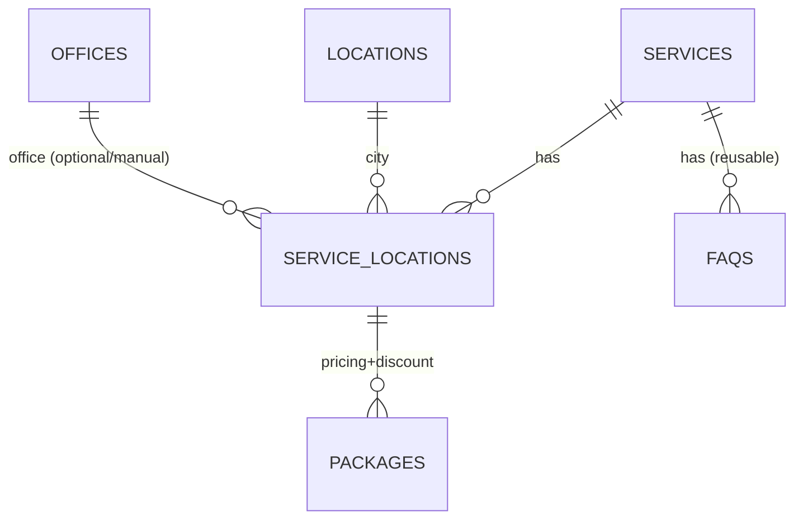

# PHASE 2A.7 — SCHEMA RECONCILIATION & DATA MAPPING UPDATE

**Project:** `/Users/4ntith3sis/Documents/My project/fix build/easyoffice`  
**Status:** Audit, analisis, pemetaan, dan dokumentasi. **Tidak ada implementasi.**  
**Keputusan:** Model C disetujui untuk dimasukkan ke rancangan schema. `ServiceLocations` menjadi collection tambahan yang direkomendasikan. Kantor/Offices **belum disetujui** - perlu persetujuan. Packages **wajib** di `Locations.packages[]`. Harga/paket direkomendasikan pindah ke `ServiceLocations` dengan kebutuhan penanda layanan.

---

## 1. Ringkasan Eksekutif

Rekonsiliasi ini memperbarui rancangan schema berdasarkan kebutuhan terbaru:
- **Services** = halaman utama layanan (deskripsi, hero, keunggulan layanan, kota tersedia, manfaat layanan, FAQ layanan, tabel perbandingan, SEO)
- **Locations** = data kota (nama, slug). **packages[] wajib di sini** namun dengan kebutuhan filter per layanan.
- **Offices (kandidat)** = entitas kantor terpisah yang bisa dipilih manual per `ServiceLocations` - **belum disetujui**
- **ServiceLocations** = halaman layanan-kota (konten terpisah per kombinasi), paket harga & diskon, referensi kantor, galeri 3 foto, fasilitas kantor, SEO khusus
- **FAQs** tetap collection, digunakan ulang per Service
- **Tabel perbandingan** mengikuti Service
- **SEO** dibutuhkan untuk Services dan ServiceLocations

---

## 2. Daftar Dokumen dan Kode yang Diperiksa

**Laporan:** `PHASE-1-AUDIT-REPORT.md`, `PHASE-2A-SCHEMA-DRAFT.md`, `PHASE-2A.1-SCHEMA-RECONCILIATION.md`, `PHASE-2A.2-DATA-MAPPING.md`, `PHASE-2A.3-SCHEMA-RECOMMENDATION.md`, `PHASE-2A.4-CONTENT-MODEL-ANALYSIS.md`, `PHASE-2A.5-SCHEMA-FINALIZATION.md`, `PHASE-2A.6-PACKAGES-PRICING-VALIDATION.md`  
**Kode:** `lib/data/mock-data.ts` (848 baris), `types/index.ts`, `app/layanan/[service]/page.tsx`, `app/layanan/[service]/[location]/page.tsx`, `components/sections/*`, `app/layout.tsx`

---

## 3. Matriks Keputusan Phase 2A

| Keputusan | Status | Keterangan |
|-----------|--------|---------|
| Baseline 8 collections + SiteSettings | **Disetujui** | Tetap dipertahankan |
| ServiceLocations sebagai collection tambahan | **Disetujui untuk rancangan** | Model C, bukan implementasi |
| Packages wajib di Locations.packages[] | **Disetujui** | Namun perlu penanda layanan atau pindah ke ServiceLocations untuk akomodasi harga per (layanan,lokasi) |
| Promotions Active/Inactive | **Disetujui** | Inactive tidak ditampilkan |
| FAQs tetap collection | **Disetujui** | Digunakan ulang per Service |
| Media lokal + Unsplash tetap | **Disetujui** | Sampai migrasi disetujui |
| Users admin/editor | **Disetujui** | Belum buat akun |
| Puck ditunda, no Docker | **Disetujui** | - |

---

## 4. Konflik dan Rekonsiliasi

| Konflik | Sumber | Penyelesaian Rekomendasi |
|---------|--------|---------------------------|
| **Packages di Locations vs harga per (layanan,lokasi)** | Phase 2A.6 menemukan paket berbeda per layanan | **Rekomendasi:** Pindahkan paket ke `ServiceLocations` (sesuai kebutuhan baru). Jika tetap di Locations, wajib `applicableServices[]`. Namun kebutuhan terbaru menyatakan paket di ServiceLocations - ini **menggantikan** rekomendasi lama. Perlu persetujuan final. |
| **Offices terpisah** | Kebutuhan baru | **Kandidat** - belum disetujui. Evaluasi perlu/tidaknya. |
| **Kota per Service manual** | Kebutuhan baru | Perlu relasi manual (Services bisa punya daftar kota yang tersedia) |
| **FAQ mengikuti Service** | Kebutuhan baru | Collection `FAQs` tetap, relasikan ke `Services` (digunakan ulang oleh semua ServiceLocations terkait) |
| **Tabel perbandingan mengikuti Service** | Kebutuhan baru | Bisa disimpan di Services atau collection terpisah, **belum diputuskan** |

---

## 5. Model Entitas dan Relasi yang Direkomendasikan

### Collections (Baseline + tambahan)
1. `Services` - halaman utama layanan
2. `Locations` (Kota) - data kota
3. `Offices` - **KANDIDAT, belum disetujui** - kantor terpisah
4. `ServiceLocations` - halaman layanan-kota (kombinasi)
5. `Testimonials`
6. `Promotions`
7. `FAQs`
8. `Media`
9. `Leads`
10. `Users`

Global: `SiteSettings`

### Relasi (konseptual)

**Catatan:** `Packages` direkomendasikan **berada di `ServiceLocations`** (bukan di `Locations`) sesuai kebutuhan terbaru. Ini berbeda dari keputusan Phase 2A.6 yang masih mempertahankan di Locations - **perlu konfirmasi persetujuan** atas perubahan ini.

---

## 6. Tabel Field Wajib dan Opsional

### Services
| Field | Tipe | Wajib | Fungsi | Status |
|---|---|---|---|---|
| `title` | Text | Ya | Nama layanan | **Disetujui** |
| `slug` | Text (unique) | Ya | URL | **Disetujui** |
| `description` | Textarea | Ya | Deskripsi layanan | **Disetujui** |
| `heroImage` | Media/Upload | Ya | Foto sampul/hero | **Disetujui** |
| `advantages` | Array of {icon, description} | Ya | Keunggulan layanan | **Disetujui** |
| `availableCities` | Relationship -> Locations (manual) | Ya | Kota tersedia (dipilih manual) | **Disetujui** |
| `benefits` | Array of {title, icon, description} | Ya | Manfaat layanan | **Disetujui** |
| `comparisonTable` | Array/structured | Ya | Tabel perbandingan | **Perlu putusan struktur** |
| `seoTitle`, `seoDescription` | Text/Textarea | Ya | SEO halaman layanan | **Disetujui** |

### ServiceLocations
| Field | Tipe | Wajib | Fungsi | Status |
|---|---|---|---|---|
| `service` | Relationship -> Services | Ya | Layanan induk | **Disetujui** |
| `location` | Relationship -> Locations (kota) | Ya | Kota | **Disetujui** |
| `office` | Relationship -> Offices | **Perlu putusan** | Kantor (dipilih manual) | **Belum disetujui** |
| `title` | Text | Ya | Nama halaman (mis. Virtual Office Bandung) | **Disetujui** |
| `description` | Textarea | Ya | Deskripsi khusus | **Disetujui** |
| `heroImage` | Media | Ya | Foto hero | **Disetujui** |
| `advantages` | Array of {icon, description} | Opsional | Keunggulan khusus | **Disetujui** |
| `packages` | Array of {name, description, price, period, features[], discountPercent, ...} | Ya | Paket & diskon | **Rekomendasi pindah ke sini** |
| `startingPrice` | Number/Text | Ya | Harga mulai (konsisten dengan paket termurah) | **Disetujui** |
| `gallery` | Array of Media (max 3) | Ya | Galeri 3 foto | **Disetujui** |
| `facilities` | Array of {name, description, icon} | Ya | Fasilitas kantor | **Disetujui** |
| `seoTitle`, `seoDescription` | Text/Textarea | Ya | SEO khusus | **Disetujui** |

### Packages (di ServiceLocations)
| Field | Tipe | Wajib | Fungsi |
|---|---|---|---|
| `name` | Text | Ya | Nama paket |
| `description` | Textarea | Opsional | Deskripsi paket |
| `price` | Number | Ya | Harga awal (Rupiah) |
| `period`/`unit` | Text/Select | Ya | Periode/unit harga |
| `features` | Array of Text | Ya | Keunggulan paket |
| `discountPercent` | Number (0-100) | Opsional | Diskon persentase |
| `priceAfterDiscount` | Number | **Bisa dihitung** | Harga setelah diskon |

### Offices (KANDIDAT - belum disetujui)
| Field | Tipe | Wajib | Fungsi |
|---|---|---|---|
| `name` | Text | Ya | Nama kantor |
| `location` | Relationship -> Locations | Ya | Kota |
| `address` | Textarea | Ya | Alamat lengkap |
| `operatingHours` | Text | Opsional | Jam operasional |
| `email` | Email | Opsional | Email |
| `phone`/`whatsapp` | Text | Opsional | Kontak |

---

## 7. Pemetaan Mock Data ke Model yang Direkomendasikan

| Data Mock | Entitas Target | Keterangan |
|-----------|----------------|---------|
| `services[]` | `Services` | Data umum layanan |
| `locations[]` | `Locations` (Kota) | Data kota |
| `serviceLocations[]` | `ServiceLocations` | Kombinasi, konten khusus, paket (pindah), galeri, fasilitas |
| `serviceLocations[].pricing[]` | `ServiceLocations.packages[]` | **Pindah** sesuai kebutuhan terbaru |
| `serviceLocations[].facilities[]` | `ServiceLocations.facilities[]` | Fasilitas kantor |
| `serviceLocations[].faqs[]` | **Dari `FAQs` collection** (relasi ke Service) | Digunakan ulang |
| `comparisonRows[]` | `Services.comparisonTable` atau terpisah | Mengikuti Service |
| `testimonials[]` | `Testimonials` | Tetap |
| `promotions[]` | `Promotions` (Active/Inactive) | Tetap |
| `generalFaqs[]` | Bisa di `FAQs` dengan konteks | Tetap collection |
| `site` | `SiteSettings` | Global |

---

## 8. Rancangan SEO Services dan ServiceLocations

### Services
- `slug` (routing)
- `seoTitle`
- `seoDescription`

### ServiceLocations
- `slug` atau bentuk URL konsisten dengan routing (`/layanan/[service]/[location]`)
- `seoTitle` (khusus)
- `seoDescription` (khusus)
- **Opsional (rekomendasi):** `canonicalUrl`, `ogImage`, `noIndex`
- **Fallback:** Jika SEO khusus kosong, bisa fallback ke SEO Service + nama lokasi - **perlu persetujuan**

**Catatan:** Jangan ubah metadata/routing saat ini.

---

## 9. Aturan Validasi Data

| Aturan | Tipe | Keterangan |
|--------|------|---------|
| Kota di ServiceLocations harus tersedia di Service.availableCities | Bisnis | Validasi wajib |
| Kantor harus sesuai kota ServiceLocations | Bisnis | Jika Offices disetujui |
| (service, location) tidak duplikat | Bisnis/DB | Cegah duplikasi halaman |
| Paket hanya dimiliki ServiceLocations | Bisnis | Sesuai kebutuhan terbaru |
| Diskon valid (0-100), harga setelah diskon dihitung | Bisnis | Validasi |
| `startingPrice` konsisten dengan paket termurah yang berlaku | Bisnis | Validasi/fallback |
| FAQ dari Service digunakan ulang (tidak duplikasi) | Bisnis | Hemat duplikasi |
| Tabel perbandingan mengikuti Service | Bisnis | Digunakan ulang |

---

## 10. Risiko dan Keputusan yang Masih Terbuka

| Keputusan | Dampak | Rekomendasi |
|-----------|--------|-------------|
| **Tambah collection `Offices`?** | Tinggi | Perlu persetujuan. Jika ya, perlu relasi ke ServiceLocations dengan validasi kota. |
| **Paket pindah ke `ServiceLocations`?** | **Sangat Tinggi** | Bertentangan dengan rekomendasi Phase 2A.6 (yang ingin tetap di Locations dengan `applicableServices`). Kebutuhan terbaru bilang pindah ke ServiceLocations. **Perlu konfirmasi persetujuan eksplisit** mana yang benar. |
| **Struktur tabel perbandingan** | Sedang | Array di Services atau collection terpisah? |
| **SEO fallback** | Sedang | Perlu persetujuan |
| **Daftar kota per Service manual** | Sedang | Relasi many-to-many Services-Locations manual |

---

## 11. Rekomendasi Langkah Berikutnya

**Hanya setelah persetujuan eksplisit:**
1. Putuskan: paket di ServiceLocations (kebutuhan terbaru) vs tetap di Locations dengan `applicableServices`
2. Putuskan: tambah collection `Offices` atau tidak
3. Finalisasi struktur comparison table dan SEO
4. Lanjut ke implementasi schema (Phase 2B)

**Saat ini:** Hanya analisis. Tidak ada perubahan dilakukan.

---

## KESIMPULAN

- **File dibuat:** `PHASE-2A.7-SCHEMA-RECONCILIATION.md`
- **Perubahan:** **Tidak ada** - tidak ada file lain diubah/ditimpa
- **Rekomendasi utama:** ServiceLocations + Offices (kandidat) untuk memenuhi pengelolaan independen per kombinasi. **Paket direkomendasikan pindah ke ServiceLocations** sesuai kebutuhan terbaru (bertentangan dengan Phase 2A.6 - **perlu konfirmasi**). FAQs dan tabel perbandingan mengikuti Service. SEO untuk keduanya.
- **Menunggu persetujuan:** Tambah `Offices`, penempatan paket (ServiceLocations vs Locations+applicableServices), struktur comparison table, SEO fallback.

**BERHENTI - Menunggu persetujuan eksplisit sebelum implementasi.**
